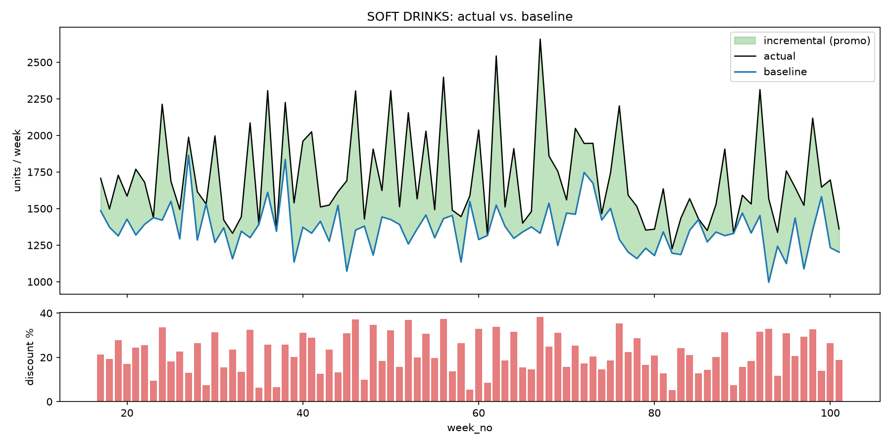
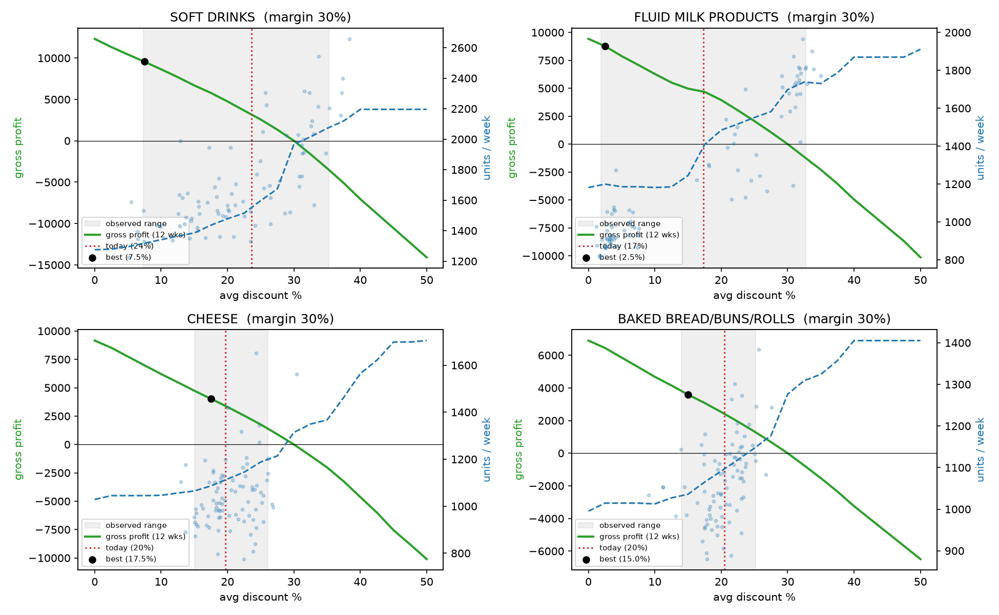
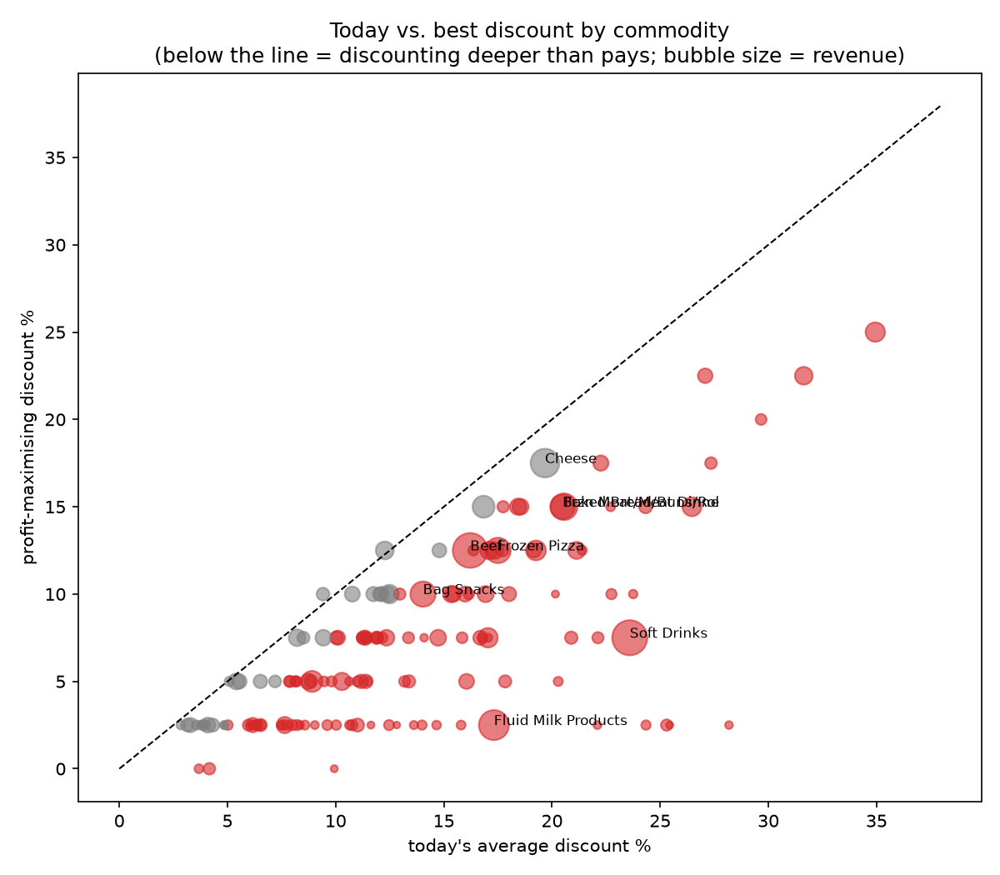
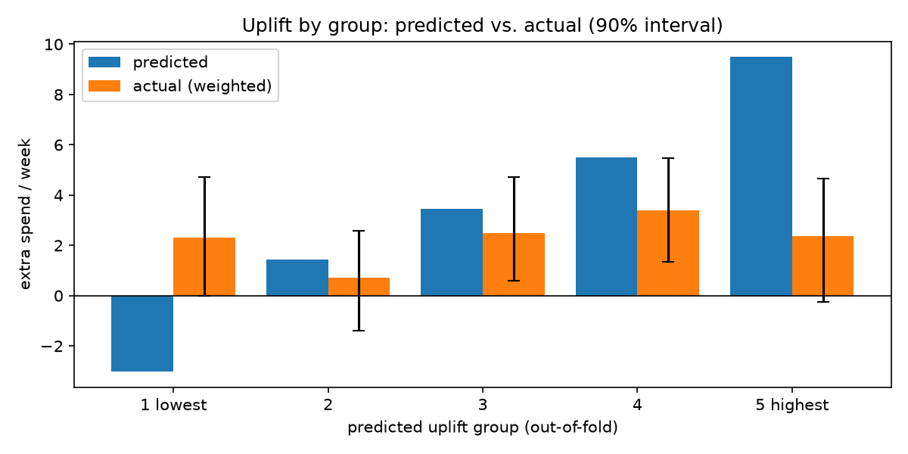

# Promo Uplift & Profit Simulator

This project started with a question I couldn't shake: retailers run promotions almost every week, but do those promos actually make money, or do they just make the sales chart look good?

When a discount drives a spike in sales, most people call it a win. But part of that spike comes from customers who were going to buy anyway. The store gets the same sale, just at a lower margin. Unless you separate those effects out, you can't really tell which promos are worth running.

I used two years of grocery transactions from about 2,500 households to find out.

## Key findings

**1. Only about 18% of volume is genuinely driven by promotions.** The rest would have sold anyway. Some categories barely respond at all. Bread is discounted about 20% on average, yet only around 4% of its volume is incremental, so most of that discount goes to people who were buying bread regardless.



**2. Most categories are discounted deeper than pays off.** At a 30% margin, a 15% discount needs twice the volume just to break even. Sales do respond (soft drinks roughly double between 5% and 35% off), but not by that much. If the store funds discounts itself, 118 of 149 categories would make more gross profit with a shallower discount and none would benefit from a deeper one.



**3. The answer depends on supplier funding, and that's the useful part.** When suppliers pay for half the discount, the picture softens but most categories are still discounted too deep. Rather than a single "right" discount, the simulator gives each category a negotiation target: about 1 in 5 categories pay off at today's depth without help, while about 2 in 5 (including soft drinks, beef and milk) need suppliers to fund 70% or more.



**4. Targeted campaigns work, but the naive numbers overstate them about 12x.** Households that received coupon campaigns spent $25.6/week more than those who didn't, but the store had picked heavier shoppers to begin with. After comparing changes in spend and weighting for who got picked, the real effect is about **$2.2/week per household**, which still pays back (about $3.3 net per targeted household, 90% interval $1.4–5.2).

**5. I couldn't reliably identify who to target.** My uplift model didn't separate high and low responders on unseen households, so I didn't use it to make targeting recommendations. The fix is a design change, not a better model: hold out a random 10–20% of targeted households in the next campaign.



## Questions I set out to answer

1. After removing the sales that would have happened anyway, how much extra volume and profit do promotions generate? → **Notebook 03**
2. What discount level still drives meaningful sales without eating the margin? → **Notebook 04**
3. If the store changed its discount depth, how would units, revenue and profit change? → **Notebook 04**
4. For targeted campaigns, who should get them and who shouldn't? → **Notebook 05**

## Data

[Dunnhumby – The Complete Journey](https://www.kaggle.com/datasets/frtgnn/dunnhumby-the-complete-journey): 2.6 million line items from about 2,500 households over 102 weeks.

I picked it mainly because it records which households received which campaign (`campaign_table`). Most public retail datasets don't have this, and without it question 4 isn't possible. It also has weekly information on which products were on display or in the mailer (`causal_data`).

The data isn't included in this repo. To run the notebooks, download it from Kaggle and put the CSV files in `data/raw/`.

## How I did it

**01 · Data understanding.** Checked coverage and quality. The first 16 weeks are a ramp-up period (households were still being added), fuel and misc lines have absurd quantities, and half of all line items carry a loyalty discount, with a median depth of 25%.

**02 · Data cleaning.** Removed fuel, misc and coupon lines, zero-value rows and the ramp-up weeks (kept 90% of rows, 84% of sales). Joined display/mailer flags from a 36-million-row file in chunks, and built a weekly table for 184 categories covering 95% of sales. Every step is logged.

**03 · Model.** One LightGBM model predicts weekly units for all categories from demand drivers (category, trend, seasonality, list price) and promo drivers (discount depth, display, mailer). Two decisions matter here:

- *Monotone constraints* on the promo features, so more discount can never predict fewer sales. Without them, the what-if simulation can produce nonsense like "22% off sells less than 20% off".
- *A realistic baseline.* This store almost never sells at 0% off, and some categories are on display nearly every week. My first version set promos to zero and overstated incremental volume at 29%. Using each category's own low-promo week brought it to 17.6%, and the baseline now meets actual sales in low-discount weeks.

On held-out weeks the model's error (WAPE) is 15.3%, against 22.7% for a simple recent-average benchmark.

**04 · Simulator.** Re-runs the model at discount levels from 0% to 50% and converts units into gross profit. Display and mailer move with the discount the way they usually do for that category, because a 30% discount with no display isn't something the store actually runs. The best discount is only searched inside the range each category has actually been sold at, so the model isn't extrapolating. A sensitivity grid varies margins and supplier funding.

**05 · Uplift.** For five large coupon campaigns, compares the change in household spend before vs. during each campaign, for targeted vs. non-targeted households. Targeting was highly predictable (propensity AUC 0.88), so I used inverse propensity weighting and trimmed households without a comparable counterpart. The uplift model (T-learner) is evaluated with cross-fitting and bootstrap intervals, and the targeting rule was fixed before looking at results to avoid cherry-picking.

A sanity check I kept coming back to: with margin *m* and discount *d*, sales need to grow by at least *d / (m − d)* just to break even. At a 30% margin, 20% off needs three times the volume. That reframed the whole project for me.

## Limitations

- **No product costs.** Margins are assumed by department (25–45%), and supplier funding isn't in the data. That's why notebook 04 reports a range of scenarios rather than one number.
- **Promotions weren't randomised.** Discounts tend to land in weeks that are already busy, and seasonal items (fruit, soup, turkey) are discounted in their peak season. I flagged those categories as low confidence, but the estimates are still associations, not proof.
- **Profit is measured per category.** Basket effects, such as a customer coming in for cheap chicken and buying other things, aren't counted, so some deep discounts may be loss leaders by design.
- **No real calendar dates**, so there are no holiday features.
- **US grocery data.** Behaviour may differ in other markets and in e-commerce.

Anything worth acting on should be tested in a few stores first.

## Repo structure

```
data/
  raw/                             Kaggle CSVs (not committed)
  processed/                       cleaned tables and model outputs (not committed)
notebooks/
  01_data_understanding.ipynb
  02_data_cleaning.ipynb
  03_model.ipynb
  04_simulator.ipynb
  05_uplift.ipynb
reports/figures/                   charts used in this README
app/                               scenario simulator dashboard (in progress)
```

## Running it

```bash
python -m venv .venv
source .venv/bin/activate
pip install -r requirements.txt
```

Put the Kaggle CSVs in `data/raw/`, then run the notebooks in order. Each one saves what the next needs to `data/processed/`.

## Progress

- [x] Define the questions and choose the dataset
- [x] Data understanding
- [x] Data cleaning
- [x] Baseline model
- [x] Simulator and optimal discount
- [x] Campaign uplift analysis
- [ ] Dashboard
- [ ] One-page executive summary

## Contact

Questions or suggestions are welcome. You can reach me at vachirasakn@gmail.com.
